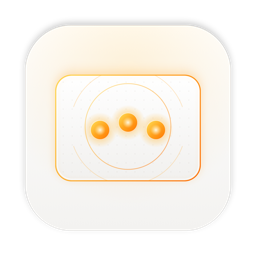

<p align="center">
  
</p>

<h1 align="center">TapDeck</h1>

<p align="center">
  <b>Your trackpad is a shortcut panel. You just haven't been using it.</b><br>
  Tap with three fingers to open an app. Tap with four to snap a window.<br>
  No keyboard, no menus, no hunting for the Dock.
</p>

<p align="center">
  <a href="https://github.com/Saba-Burduli/tapdeck/actions/workflows/ci.yml"></a>
  
  
  <a href="LICENSE"></a>
</p>

---

## The idea

Your hands are already on the trackpad. TapDeck turns quick multi-finger taps into shortcuts for the things you do all day, so they're one tap away instead of a keyboard combo you have to remember.

| Do this on the trackpad | TapDeck does |
|---|---|
| **3-finger double tap** | Opens Claude, or hides it if it's already in front |
| **4-finger tap** | Snaps the window to the left half |
| **4-finger double tap** | Snaps the window to the right half |
| **5-finger tap** | Play / pause |
| **Rest 3 fingers for a moment** | Mission Control |
| **Tap the top-right corner** | Spotlight |

Those are just the starter set. Every gesture can do whatever you want.

## What you can set up

**Gestures**
- Taps with **1 to 5 fingers**, once, twice or three times
- **Light taps or full clicks.** Press until the trackpad clicks, or just touch it; both count.
- **Holds:** rest your fingers still
- **Corner taps:** one finger in any of the four corners

**Actions**
- **Open or toggle any app**
- **Press any keyboard shortcut.** Record it by pressing the keys.
- **Move windows:** left or right half, top or bottom half, fill the screen, center, or next display
- **Media keys:** play/pause, next, previous, volume, mute

**Make it yours**
- **Record a gesture** by just doing it on the trackpad
- **Tune the sensitivity** to how you tap, with a live view of your fingers on the pad
- Lives quietly in the **menu bar** and can **launch at login**

## Built to feel instant

TapDeck reads your fingers straight from the trackpad, about 100 times a second, and fires a gesture the moment it's certain. It only waits when a longer gesture is still possible, such as a double tap when a triple tap is also set up.

It was tuned on real hands:
- Fingers that land a few milliseconds apart still count as one tap.
- A finger that drifts doesn't turn a tap into a swipe.
- Slow, firm presses that click still count as taps.

TapDeck only *listens*: it never blocks or changes your trackpad input, so pointing, clicking, scrolling and system swipes keep working. A gesture still reaches macOS too, so a one-finger corner tap also clicks where the pointer is.

## Private by design

TapDeck runs entirely on your Mac. No account, no analytics, no network calls. Your settings are one small file in `~/Library/Application Support/TapDeck/`.

## Install

> **Status: early.** The first public release is on its way. Until then, build it from source (below); it takes about a minute.

When releases are out: download `TapDeck-<version>.dmg` from [Releases](https://github.com/Saba-Burduli/tapdeck/releases) and drag TapDeck to Applications. Until releases are notarized by Apple, macOS blocks TapDeck the first time you open it. Go to **System Settings → Privacy & Security** and click **Open Anyway**.

**Permission:** on first launch, TapDeck asks for **Accessibility** access, which it needs to press shortcuts, move windows and use media keys. Opening apps works without it. If TapDeck shows as switched on in System Settings but still isn't working, see **Settings → General** in TapDeck for a one-line fix.

**Requires** macOS 14 Sonoma or later, with a built-in trackpad or a Magic Trackpad.

## Build from source

You need Xcode with Swift 6.

```bash
git clone https://github.com/Saba-Burduli/tapdeck.git
cd tapdeck
scripts/build-app.sh --run
```

This builds `dist/TapDeck.app` and opens it in your menu bar. Run the tests with `swift test`.

<details>
<summary><b>Keeping the Accessibility permission across rebuilds</b></summary>

macOS ties the permission to the app's signature. With ad-hoc signing, every rebuild counts as a new app. Create a self-signed code-signing certificate named **`TapDeck Dev`** in your login keychain, and `build-app.sh` signs with it automatically, so the permission sticks.
</details>

## How it works

```
Trackpad ─▶ TouchInput ─▶ Recognizer ─▶ Engine ─▶ Actions
            raw fingers    taps, holds,   your        apps, keys,
            ~100×/second   corners        shortcuts   windows, media
```

- **TouchInput** reads raw finger contacts through Apple's private `MultitouchSupport` framework, the same approach as BetterTouchTool and Jitouch. That's why TapDeck lives outside the Mac App Store.
- **Recognizer** is a pure Swift state machine with no system calls, so it's fully unit-tested, including recordings of real taps and presses.
- **Engine** recognizes gestures off the main thread and sleeps between touches, so it uses next to nothing while idle.
- **Actions** use public macOS APIs: NSWorkspace, CGEvent and Accessibility.

## Roadmap

- [x] System-wide multi-finger taps, holds and corner taps
- [x] Apps, shortcuts, window snapping and media actions
- [x] Menu bar app with gesture recording and sensitivity tuning
- [ ] Notarized release and Homebrew install
- [ ] Per-app shortcuts (a different action depending on the app in front)
- [ ] Import and export shortcut sets

<details>
<summary><b>Releasing (maintainers)</b></summary>

Push a version tag, for example `git tag v0.1.0 && git push origin v0.1.0`. The release workflow then tests and builds the DMG and creates a **draft** GitHub release for you to review and publish. To package locally, run `scripts/package-release.sh`.

To sign and notarize, add these repository secrets: `DEVELOPER_ID_P12` (your base64 `.p12`), `DEVELOPER_ID_P12_PASSWORD`, `SIGN_IDENTITY` (`Developer ID Application: Name (TEAMID)`), `APPLE_ID`, `APPLE_TEAM_ID` and `APPLE_APP_PASSWORD`. Without them, releases are ad-hoc signed. A Homebrew cask template is in `packaging/homebrew/tapdeck.rb`. To regenerate the app icon, run `scripts/make-icon.sh`.
</details>

## License

[MIT](LICENSE) © Saba Burduli
